# IFC Viewer examples

Explore building models, point clouds and BIM review workflows with the Flinker IFC Viewer.

Click a preview or example title to open a demo. Internet access is required to load the viewer and sample files.

Example code is licensed under [Apache 2.0](LICENSE). The SDK and sample assets have separate licenses; see [third-party notices](THIRD_PARTY_NOTICES.md).

## Examples

<!-- generated:examples:start -->

| Preview | Example | Description |
| --- | --- | --- |
| [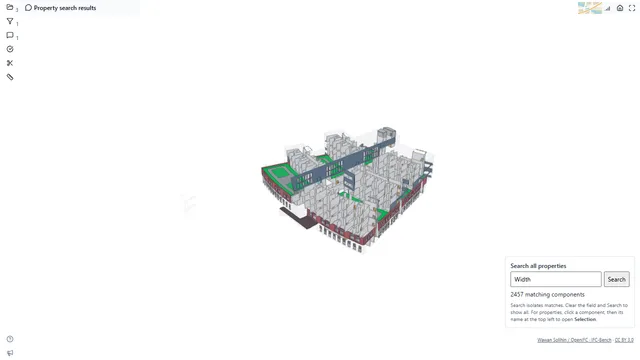](https://viewer.flinker.app/examples/component-lookup/index.html) | [Search component properties](https://viewer.flinker.app/examples/component-lookup/index.html) [Source](examples/component-lookup/index.html) Asset information, IFC, BCF, Full property search BIM workflow | Search component names, properties, quantities, materials and classifications, then show only the matching components. |
| [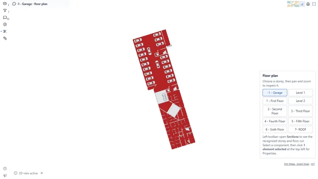](https://viewer.flinker.app/examples/floorplans/index.html) | [Open saved floor plans by storey](https://viewer.flinker.app/examples/floorplans/index.html) [Source](examples/floorplans/index.html) Buildings, IFC, BCF, Floor plans, Storey recognition, 2D navigation BIM workflow | Choose a storey to open its saved floor plan, then pan and zoom to inspect the layout. |
| [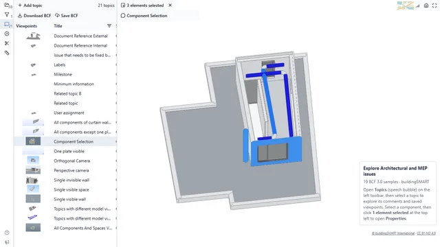](https://viewer.flinker.app/examples/bcf/index.html) | [Explore Architectural and MEP BCF issues](https://viewer.flinker.app/examples/bcf/index.html) [Source](examples/bcf/index.html) Coordination, IFC, BCF, BCF review BIM workflow | Explore buildingSMART BCF 3.0 issues for the Architectural and MEP models, including comments and saved viewpoints. |
| [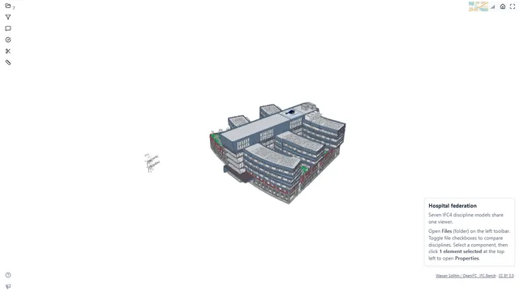](https://viewer.flinker.app/examples/west-riverside-hospital/index.html) | [Federate West Riverside Hospital](https://viewer.flinker.app/examples/west-riverside-hospital/index.html) [Source](examples/west-riverside-hospital/index.html) Buildings, IFC, Federation BIM workflow | Explore West Riverside Hospital&#39;s seven IFC4 discipline models federated in one viewer: architecture, structure and building services. |
| [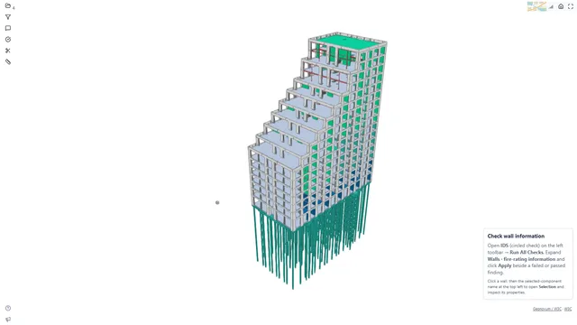](https://viewer.flinker.app/examples/s1-ids/index.html) | [Check wall names and fire-rating information](https://viewer.flinker.app/examples/s1-ids/index.html) [Source](examples/s1-ids/index.html) Validation, IFC, IDS, 2 specifications, Federation, Information quality, Fire-rating information BIM workflow | Run IDS checks to find walls with missing names or fire-rating values, then highlight passing or failing components. |
| [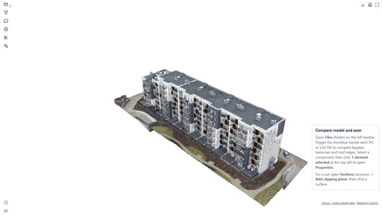](https://viewer.flinker.app/examples/building-scan/index.html) | [Compare a building model with its scan](https://viewer.flinker.app/examples/building-scan/index.html) [Source](examples/building-scan/index.html) Reality capture, IFC, LAZ, Model and point cloud, Scan comparison BIM workflow | Compare a building IFC with its matching colour point cloud to inspect façades, balconies and roof edges. |
| [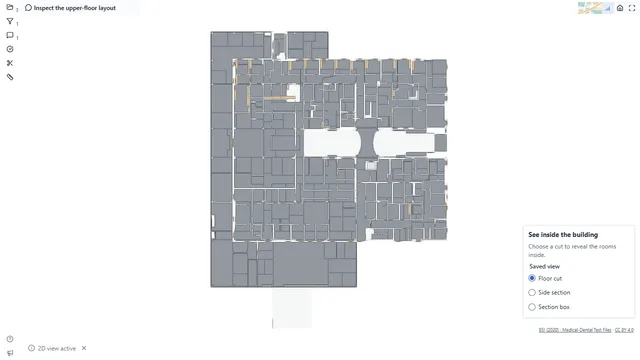](https://viewer.flinker.app/examples/bcf-clipping/index.html) | [See inside a building with sections](https://viewer.flinker.app/examples/bcf-clipping/index.html) [Source](examples/bcf-clipping/index.html) Coordination, IFC, BCF, clipping, Viewpoints Developer integration | Choose a saved floor cut, side section or section box to reveal rooms and components inside a building. |
| [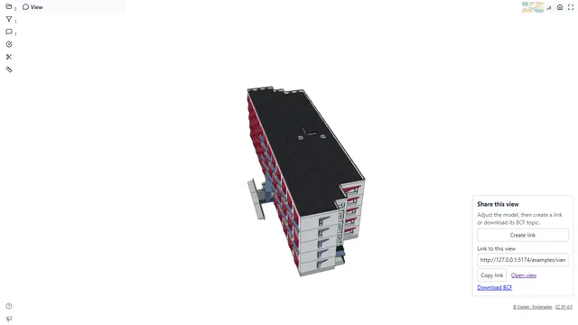](https://viewer.flinker.app/examples/view-link/index.html) | [Share a model view with a link](https://viewer.flinker.app/examples/view-link/index.html) [Source](examples/view-link/index.html) Integration, IFC, BCF, Create BCF topic, Share link, Restore view Developer integration | Create a BCF topic from the model view, then share its link or download the BCF file. |
| [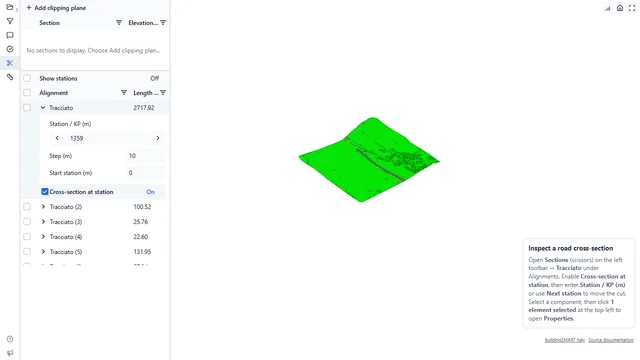](https://viewer.flinker.app/examples/infra_Road/index.html) | [Explore road cross-sections](https://viewer.flinker.app/examples/infra_Road/index.html) [Source](examples/infra_Road/index.html) Infrastructure, IFC, Alignments, Roads, Sections BIM workflow | Move a section cut along a road alignment to compare the road profile at different distances along the route. |
| [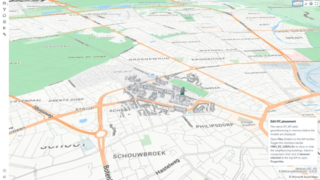](https://viewer.flinker.app/examples/s1-context/index.html) | [Edit IFC georeferencing with web-ifc](https://viewer.flinker.app/examples/s1-context/index.html) [Source](examples/s1-context/index.html) SDK integration, IFC, Native IFC editing, Georeferencing, Federation Developer integration | Use the native IFC API to position the S1 building and 3DBAG surroundings, then display the edited models on a map. |
| [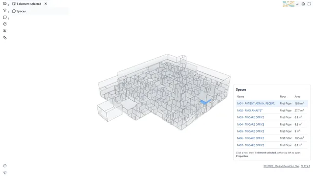](https://viewer.flinker.app/examples/ifc-quantity-takeoff/index.html) | [Select spaces from a table](https://viewer.flinker.app/examples/ifc-quantity-takeoff/index.html) [Source](examples/ifc-quantity-takeoff/index.html) IFC data, IFC, Space table, Selection BIM workflow | Browse space names, floors and stored areas, then click a row to select the space in the model. |
| [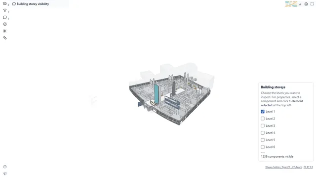](https://viewer.flinker.app/examples/storey-visibility/index.html) | [Show or hide building storeys](https://viewer.flinker.app/examples/storey-visibility/index.html) [Source](examples/storey-visibility/index.html) Buildings, IFC, BCF, Storey visibility BIM workflow | Choose which storeys to display using the building components assigned to each level. |
| [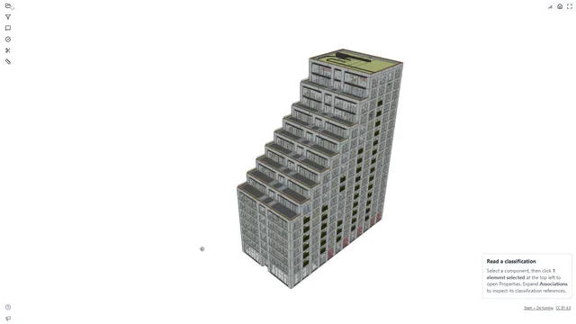](https://viewer.flinker.app/examples/sixty5/index.html) | [Inspect component classifications](https://viewer.flinker.app/examples/sixty5/index.html) [Source](examples/sixty5/index.html) Buildings, IFC, Large models, Properties, Classification, Search BIM workflow | Select a building component to read its properties and classification references, then compare it with another component. |
| [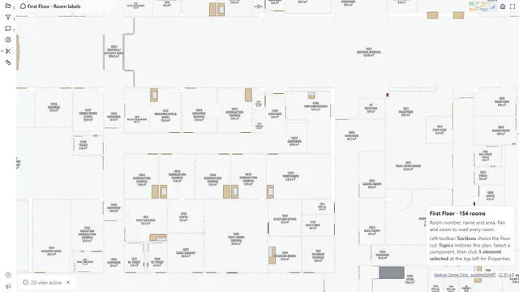](https://viewer.flinker.app/examples/room-info/index.html) | [Read room labels on a floor plan](https://viewer.flinker.app/examples/room-info/index.html) [Source](examples/room-info/index.html) Buildings, IFC, BCF, PNG, Floor plans, Room labels BIM workflow | Read room numbers, names and areas for all 154 rooms on the clinic’s first floor. |
| [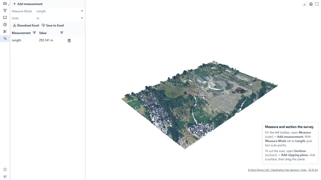](https://viewer.flinker.app/examples/autzen/index.html) | [Measure and section a point cloud](https://viewer.flinker.app/examples/autzen/index.html) [Source](examples/autzen/index.html) Reality capture, LAZ, LiDAR, Classified source, Large scans, Measurements, Sections BIM workflow | Measure distances between scan points and cut through a site survey to inspect ground, buildings and vegetation. |
| [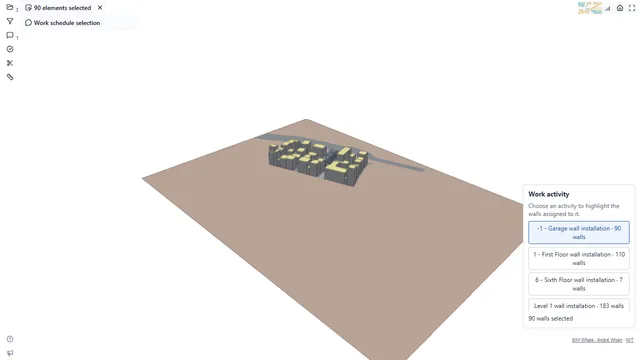](https://viewer.flinker.app/examples/selection/index.html) | [Select elements from a work schedule](https://viewer.flinker.app/examples/selection/index.html) [Source](examples/selection/index.html) Host integration, IFC, BCF, Selection Developer integration | Choose a wall-installation activity to highlight the walls assigned to it in the building model. |
| [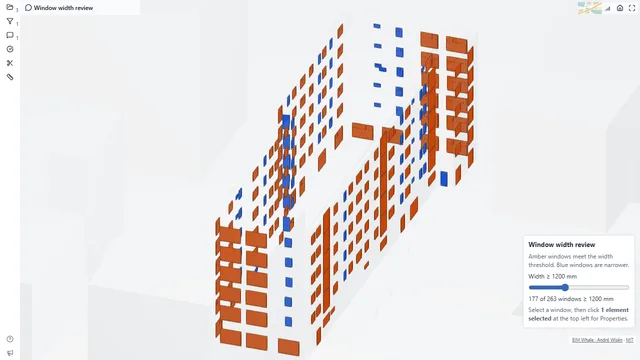](https://viewer.flinker.app/examples/window-width/index.html) | [Find windows by width](https://viewer.flinker.app/examples/window-width/index.html) [Source](examples/window-width/index.html) Buildings, IFC, BCF, Window dimensions BIM workflow | Compare window widths against a nominal size threshold and highlight the matching windows. |
| [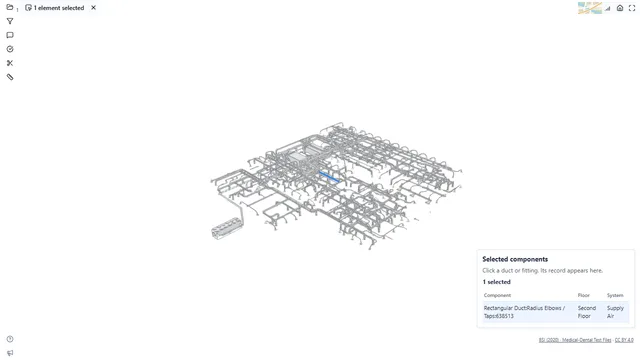](https://viewer.flinker.app/examples/view-table/index.html) | [Show selected components in a table](https://viewer.flinker.app/examples/view-table/index.html) [Source](examples/view-table/index.html) Integration, IFC, Selection, Linked table Developer integration | Click a duct or fitting to see its name, floor and system in a table. Select more components to compare their records. |
| [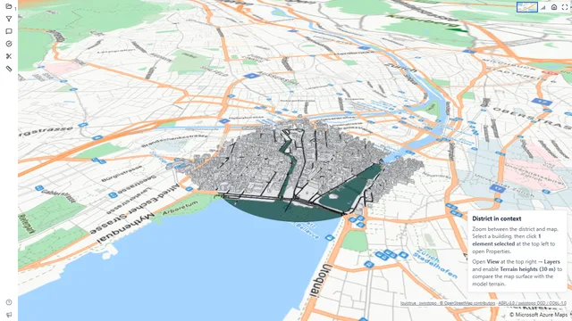](https://viewer.flinker.app/examples/zurich-district/index.html) | [View a district with buildings and terrain](https://viewer.flinker.app/examples/zurich-district/index.html) [Source](examples/zurich-district/index.html) Infrastructure, IFC, Georeferencing, Urban context, Terrain, Large models BIM workflow | View district buildings and model terrain on a map, then turn on map terrain to compare the wider landscape. |
| [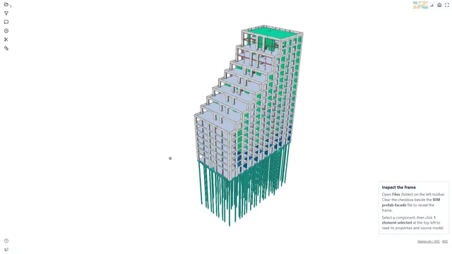](https://viewer.flinker.app/examples/s1-structure/index.html) | [Inspect connections between building models](https://viewer.flinker.app/examples/s1-structure/index.html) [Source](examples/s1-structure/index.html) Buildings, IFC, Federation, Structure, Facade, Visibility BIM workflow | View the structural frame, facade and stairs together, then hide the facade to inspect where the models meet. |
| [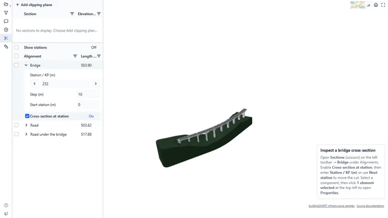](https://viewer.flinker.app/examples/infra/index.html) | [Explore bridge cross-sections](https://viewer.flinker.app/examples/infra/index.html) [Source](examples/infra/index.html) Infrastructure, IFC, Alignments, Bridges, Sections BIM workflow | Move a section cut along a bridge alignment to inspect the structure at different distances along the route. |
| [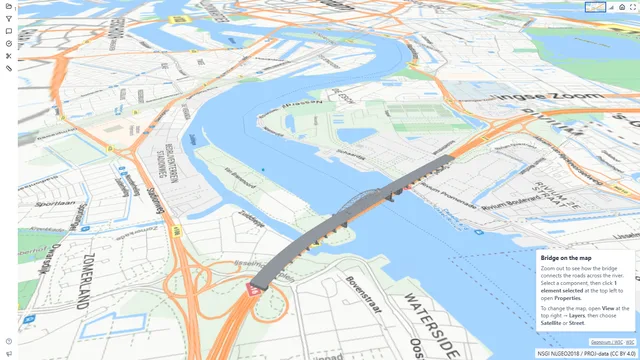](https://viewer.flinker.app/examples/rotterdam-bridge/index.html) | [View a bridge on a map](https://viewer.flinker.app/examples/rotterdam-bridge/index.html) [Source](examples/rotterdam-bridge/index.html) Infrastructure, IFC, IFC4x3, Bridges, Maps BIM workflow | See how a bridge connects the surrounding roads across a river, and switch between street and satellite maps. |
| [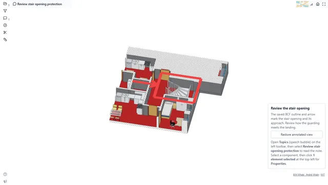](https://viewer.flinker.app/examples/bcf-annotations/index.html) | [Review saved annotations at a stair opening](https://viewer.flinker.app/examples/bcf-annotations/index.html) [Source](examples/bcf-annotations/index.html) Coordination, IFC, BCF, Annotations, Viewpoints BIM workflow | Open an existing BCF outline and arrow in a close section view to review the stair opening and its approach. |
| [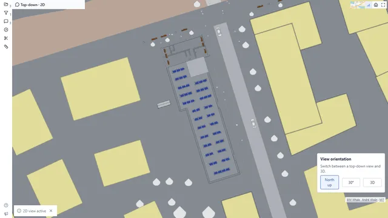](https://viewer.flinker.app/examples/bcf-2d/index.html) | [Switch between top-down and 3D views](https://viewer.flinker.app/examples/bcf-2d/index.html) [Source](examples/bcf-2d/index.html) Buildings, IFC, BCF, 2D views Developer integration | View the whole building from above, choose a north-up or rotated view, then return to 3D. |
| [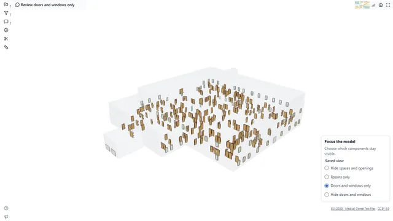](https://viewer.flinker.app/examples/bcf-visibility/index.html) | [Show or hide component groups](https://viewer.flinker.app/examples/bcf-visibility/index.html) [Source](examples/bcf-visibility/index.html) Coordination, IFC, BCF, visibility, Viewpoints Developer integration | Switch between saved visibility presets to show only rooms, focus on doors and windows, or hide spaces and openings. |
| [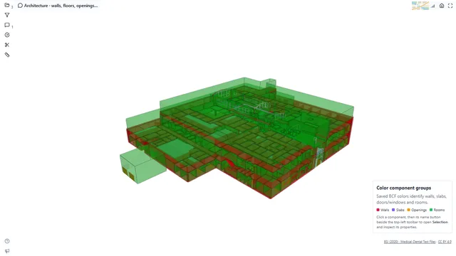](https://viewer.flinker.app/examples/bcf-coloring/index.html) | [Color components by type](https://viewer.flinker.app/examples/bcf-coloring/index.html) [Source](examples/bcf-coloring/index.html) Coordination, IFC, BCF, coloring, Viewpoints Developer integration | Use different colors for walls, slabs, doors, windows and rooms so each group is easy to identify. |
| [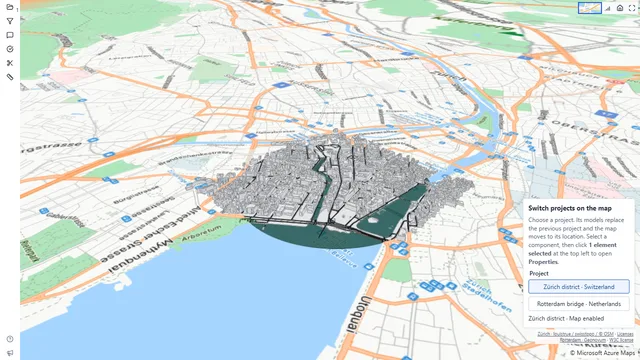](https://viewer.flinker.app/examples/dispose/index.html) | [Switch between projects on a map](https://viewer.flinker.app/examples/dispose/index.html) [Source](examples/dispose/index.html) Host integration, IFC, Model lifecycle, Project switching, Georeferencing, Maps Developer integration | Choose a project to replace the loaded model and move the map to its location in the same viewer. |
|  | [Show messages in the viewer](https://viewer.flinker.app/examples/account/index.html) [Source](examples/account/index.html) Host integration, Messages Developer integration | Choose a message type, enter your own text and preview information, success, warning, error or loading messages in the viewer. |

<!-- generated:examples:end -->
